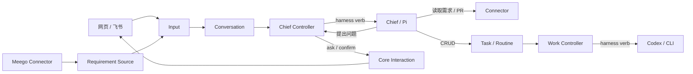

# Chief 与主动发现

Chief 是 Aide 的入口 Agent，由内置 Pi Agent 承担。它接收用户消息和外部观察，读取上下文、判断是否值得跟进，再直接回答、询问用户或操作 Work。普通问答可以直接查文件、调用 CLI，不必创建 Task。



## 身份与职责

Connector 负责访问外部平台和映射数据。当前有 Meego、GitHub 和 GitLab；Connector 不创建 Work、不作用户决策。Meego 调用本机 `meegle` CLI，沿用其 profile；Forge 使用统一 HTTP 客户端，单请求超时 10 秒、响应上限 4 MiB，遇到限流暂停后续请求。

Source 定义关注范围、定期读取摘要、比较观测指纹，将新观察持久化为 Input。先写输入，再推进水位；写入中断后的重试不会生成同一观察的第二份输入。调度使用已有 Source / Controller / requeueAfterMs，不另外实现轮询运行时。Source 不直接调用 Pi。

Conversation、Input、Message 是 Host 管理的内置对象，以普通记录持久化在 Session 的 `conversations.json` 中，并通过内置 Resource API 向 Plugin 提供投影。它们不进入 PluginResourceStore，也不需要每条输入注册或调度一个自定义 Resource。Chief 观察 Conversation 的变化，按会话串行消费待处理 Input；等待某个会话的用户或 Harness 时，其它会话可以继续。

Message 表达交流记录，Input 表达一次待处理触发。Channel Input 引用用户 Message，正文只存一份；Source Input 保存外部观察，不自动产生聊天消息。回复和输入状态在一次原子文件替换中提交。

Input 与 Work 有不同生命周期。输入按会话内消息 id 或 Source 观察身份去重，状态是未开始、running、waiting、done、failed。只有明确的有限目标或持续职责才进入 Work。一个会话同时只有一个活跃 Input；其它输入排队，不会争用同一份 Work 工具绑定。

Channel 自己决定 conversationId：当前飞书单聊使用机器人账号与 chat ID，网页使用 URL 的 conversation 参数；群聊按群划分的路由可沿用该接口，但本轮没有开启飞书群消息接收。Source 的每个 watch 默认使用 `source:<watch-id>`，与 Connector 身份无关；显式配置 conversationId 可投到已有会话。独立 Source 会话可用网页 `/?conversation=source:<watch-id>` 查看；只有路由到已有 Channel 会话时才沿用该 Channel 投递。

每个会话绑定一个 Pi Target；每份输入使用独立 Lane，询问后的续答继续同一原生 Pi 会话。近期 30 条持久消息进入上下文，Work 工具可查询完整工作记录；这还不是长期记忆系统。开发工作继续使用原有 Codex Target、Work Controller 和结果校验。

编程领域沿用 `Repository = forge + path` 身份；Requirement 为 `source + category + id`，PR/MR 为 `forge + path + number`。关注配置携带候选仓库，Chief 在 Work instruction 中保留具体身份和工作目录。第一版没有额外的需求—Work—PR 关联表，也没有自动匹配仓库 checkout。

## 决策与问答

Chief 拥有原生文件/CLI 工具、五个 Work 工具，以及 `read_requirement`、`list_pull_requests`、`read_pull_request`、`read_pull_request_comments`、`list_connectors`。

`ask` 和 `confirm` 工具提出问题意图，Pi 结束当前 Turn 后，Chief Controller 调用已有 Core verb。等待用户不占模型执行位。Core Interaction 持有问题、答复、取消和超时；没有增加第二套审批状态。提出问题之后，当前轮的 Work 写工具拒绝继续修改，收到答复后才重新开放。拒绝是正常业务答案，Chief 收到 `declined`，不能当作执行授权。

网页可直接回答 Interaction；飞书同一会话下一条文字回答当前问题。确认问题接受选项值、标签和明确的“确认／拒绝”等表达；不明确的确认回答会提示选择，不继续执行。自由问答允许文字答案。其它会话的消息不能回答这个问题。当前一次只处理一个问题，不支持飞书引用特定历史问题作答；Hooks 信任和 Harness 权限请求仍在网页处理。

Source 观察没有用户指令的地位。Chief 应读取详情、查询已有 Work；在已有委托内可以推进工作，缺少目标或授权时询问。不值得打扰的观察可调用 `dismiss_observation`，保存原因但不向 Channel 发消息。

普通回复保存到 Conversation 的 Message 流，Input 保留消息引用，Core 问题按原 messageId 投影到同一 Channel 消息流。POST `/messages` 返回入站持久回执，业务结果异步出现；没有每次固定发出的“已创建事项”回复。模型进度不会重复投递为最终回复。

Chief 可能调用有副作用的工具，因此运行中断、失败或重启均不自动重放。状态和失败提示保留，用户核对后用新消息重新交办。同一输入 id 的传输重投永远不作为业务重试。等待中的调用栈不跨重启恢复，Core 问题会收口，Input 标记 failed；Work 的 uncertain / invalid_result 规则保持原样。

## 配置

默认读取 `$AIDE_HOME/connectors.json`（未设 AIDE_HOME 时为 `~/.aide/connectors.json`），也可用 `AIDE_CONNECTORS` 指定文件。无配置时仍可聊天、操作 Work 和使用已有 CLI。示例中的标识需要换成自己的真实值：

```json
{
  "requirements": {
    "work": {
      "provider": "meego",
      "projectKey": "your-project-key",
      "profile": "your-meegle-profile",
      "categories": ["story"],
      "assigneeField": "current_status_operator",
      "userKeys": ["your-user-key"]
    }
  },
  "forges": {
    "github.com": { "type": "github", "token": "your-token" },
    "gitlab.example.com": { "type": "gitlab", "token": "your-token" }
  },
  "watches": [{
    "id": "my-requirements",
    "source": "work",
    "conversationId": "me",
    "intervalMs": 300000,
    "repositories": [{ "forge": "github.com", "path": "org/repo" }]
  }]
}
```

Meego 的“我名下”按指定负责人字段中的稳定 user key 匹配，不按参与人或显示名。默认字段是当前节点处理人；项目若用单独的需求负责人字段，必须配置 `assigneeField`。`userKeys` 对开启的 watch 必填，避免意外观察整个项目。Meegle 单命令超时 20 秒、输出上限 4 MiB。

Forge 的配置 key 是逻辑身份，`api_host` 可以覆盖 API 域名，`uids` 可选过滤 PR 作者。`GITHUB_TOKEN` / `GH_TOKEN`、`GITLAB_TOKEN` 优先于文件 token；没有凭证的 Forge 不启用。服务环境需能找到 `meegle` 并访问其登录态，不能只在交互 shell 中配置 PATH。

飞书目标为 `feishu:<app-id>:<chat-id>`，可从入站日志的 conversationId 获取。机器人需要已经收到过该单聊的消息，才会向其投递。模型沿用 Pi 的 `~/.pi/agent` 配置；`AIDE_MODEL` 只控制开发用 Codex。修改连接器配置后重启 Aide。

第一版 Meego 每个类别读取最近更新的 50 条，再筛选负责人；不保证覆盖高流量项目的全量变更。首次连接会把这批范围内尚未结束的条目交给 Chief；配置范围改变也会建立新的观察范围。后续仅在指纹变化时再次提交。尚未接 webhook、全量分页或 Forge 定时 Source；Forge 当前供 Chief 查询 PR 状态与评论。

## 验证

`tests/chief.test.ts` 跑真实 Plugin Worker、Source、Pi SDK 和本地模型协议服务，验证需求读取、飞书确认拒绝、自由回答、创建 Work 和 Codex 执行链路；模型与 Meegle 输出、飞书发送和 Codex 执行是替身。`tests/conversation.test.ts` 验证消息引用、持久化、会话串行与隔离、待处理输入恢复和中断不重放；`tests/requirements.test.ts` 验证负责人筛选、水位中断与去重；`tests/forge.test.ts` 覆盖 GitHub/GitLab 协议映射、评论、限流与错误行为。这些检查不代表真实账号连通或模型判断质量已验证。
