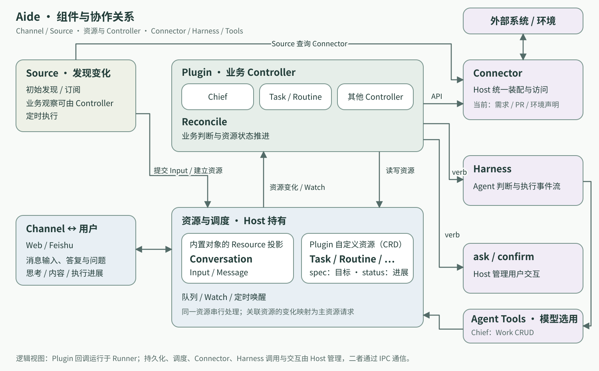
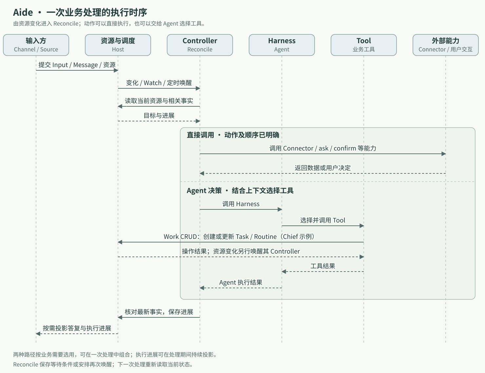

# Aide 的执行内核

Aide 由 Channel、Source、资源与 Controller、Connector、Harness 等组件协作。Plugin 组织业务资源及其 Reconcile，Core 提供持久化、调度、交互与执行能力。本篇先说明组件的职责与关系，再说明一次业务处理如何在这些组件之间推进。

## 第一部分：组件与协作关系

图中左侧是输入，上方是业务逻辑，右侧是能力与外部系统；中央 Core 连接三个领域；框下的 Host + Runner 标注其进程实现。Source 通过 Core 服务观察外部变化；Reconcile 通过 Verb 发起动作，再由 Connector、Harness 或交互能力执行。组件位置表达逻辑协作关系，进程所有权见下文。Chief、Task、Routine 是 Personal Plugin 的具体业务，其他 Plugin 可以定义自己的资源和 Controller。

| 概念 | 职责 |
| --- | --- |
| Channel | 接收用户消息，提交 Input / Message，并展示答复、问题与执行进展；Web 和 Feishu 是两个实现 |
| Source | 定义观察范围，通过 Core 请求外部查询或订阅，把观察结果转为资源或 Input |
| Core / Verb | Core 提供共享协作机制，Verb 是 Controller 的动作出口，表达外部查询、操作、AI 执行和用户交互 |
| Connector | 适配外部系统与环境，由 Core 装配并调用，处理提供方协议与数据映射 |
| Resource | 保存业务身份、目标与进展；内置对象有 Resource 投影，Plugin 也可定义自己的资源类型（CRD） |
| Controller / Reconcile | 围绕主资源读取最新事实、决定动作、保存结果，并安排下一次处理 |
| Harness | 提供 Agent 执行能力，由 Core 统一管理调用与执行事件 |
| Plugin | 组织资源定义、Controller、Source 等业务能力，是扩展的装配与所有权单位 |

这里沿用 Kubernetes Operator 的工作方式：用资源表达需要持续推进的目标，用 Reconcile 根据当前事实推进目标。业务增加时，在 Plugin 内定义相应的资源和 Controller；一个较大的业务可以由多组资源与 Reconcile 协作完成。

### Core 与 Controller 的动作出口

Core 是系统共享的协作引擎，组件层面统一承接资源、调度、交互与执行职责。Verb 表达 Controller 向 Core 发起的动作，涵盖 Connector 查询与操作、Harness 执行以及 ask / confirm 等用户交互。Reconcile 读取资源、决定动作，再通过 Verb 请求执行；资源进展经 ResourceClient 保存。

Source 决定关注什么、如何解释观察结果，Core 承接查询或订阅请求，再通过 Connector 访问外部系统。Reconcile 决定下一步业务动作，通过 Core 发起执行。Agent 工具、Channel 和框架 Source 可以按职责直接调用 Core 服务，不要求经过 Verb。例如 Chief 的 Work 工具调用 Core ResourceClient，Connector 工具调用 Core ConnectorClient。

Core 在资源和能力边界上组织审计、授权、超时与执行记录，Connector 专注外部协议，Controller 专注业务判断。组件图按这个完整职责模型展示审计与授权。

Controller 使用 `ctx.verbs.connectors({ timeoutMs })` 调用 Connector，普通组件使用 ConnectorClient；两者访问同一份 Host 客户端。Connector verb 直接执行，不创建用户 Interaction。超时表示等待结束，不保证提供方操作已取消。图中的审计与授权表达 Core 的职责，当前未建设完整的授权策略或通用审计流水。

### Controller 与资源协作

每个 Controller 的 `resourceType` 指定一种主资源，Reconcile 围绕其中一个资源实例运行。`watches` 可以监听其他资源类型，并将变化映射为主资源的 Reconcile 请求。

所有业务资源写入，包括 Agent 工具的 CRUD，都经 Core ResourceClient 发布变更。主资源的创建、spec / metadata 变化和删除会自动唤醒 Controller；纯 status 更新交给显式 Watch，避免 Reconcile 写入自身状态导致忙循环。

多个 Controller 因而可以通过资源状态协调：一个 Controller 保存结果，另一个 Controller 通过 Watch 感知变化，再读取结果推进自己的目标。例如，一个复合业务可以拥有父资源和多个子资源；子资源各自执行，父 Controller 监听子资源变化，汇总进度并决定父目标是否完成。这是扩展方式示例，具体关联和完成条件由业务定义。

### 实现：Host / Runner 的进程分工

Core 内部拆分 Host 与 Runner，主要为了隔离 Plugin、CRD 相关处理和 Controller 执行中的卡顿，避免干扰用户交互。这些插件回调由 Runner 执行，用户交互由 Host 承接，二者通过 IPC 协作。这个拆分属于技术实现，讨论组件职责与协作时统一称为 Core。

Runner 的设计定位是一个相对单纯、参考 Kubernetes controller-runtime 的单进程运行环境：加载 Plugin，承载 CRD / Controller 注册以及 Source、Watch、Reconcile 回调。同一 Runner 内的这些工作共享一个进程，通过 Core 的资源与能力接口协作。这里借用的是 controller-runtime 的资源协调模型。

Host 持有资源、消息和执行事实，管理 Harness、用户交互及 Runner 生命周期。Runner 拥有插件 Controller 的 Watch 映射、队列、并发容量、Source、重试和定时唤醒，经 IPC 读取资源及请求动作。Host 为一次执行签发身份并核对结果提交，调度容量只由 Runner 管理，避免跨进程重复限流造成相互等待。每个启用的插件实例有自己的 Runner；Harness 也可能创建子进程。

Host 与 Runner 不相互导入实现。Host 通过入口启动 Runner；两端共用的 IPC 与 verb 契约放在 `src/protocol/`，上下文构造放在 `src/plugin-context.ts`，队列和定时机制放在 `src/reconcile/`。应用装配位于 `src/app.ts`，宿主会话协调器称为 CoreSession。插件开发者依赖 `packages/plugin/`，无需处理 IPC。插件运行细节见 [Plugin](plugin/README.md)。

### 输入与交流记录

Conversation 表达一组交流上下文，Input 表达一次待处理触发，Message 表达交流记录。Channel Input 引用用户 Message，Source Input 携带观察；外部观察不会自动成为一条聊天消息。

三者由 Core 的 ConversationStore 管理，以普通记录持久化，并通过内置 Resource API 提供访问与调度投影。它们不进入插件的 Resource 文件存储。输入状态和对应消息一起提交，避免只写完成状态却遗漏答复。

Conversation 的划分由输入方确定，消费顺序与处理策略由插件决定。Personal 的 Chief 按会话串行消费 Input；这是 [Personal](plugin/personal.md) 的业务约定。当前所有会话属于同一用户和同一执行身份，conversationId 不是权限边界。

### Harness 与执行事实

HarnessAdapter 统一启动、提交、取消、恢复和事件流。Target 标识一份具体执行配置，`harness` 字段选择 Harness；同一 Harness 可以有多个 Target。具体契约与职责见 [Harness](harness/README.md)，实现分别见 [Pi](harness/pi.md) 与 [Chief](harness/chief.md)。

Session 保存执行上下文和事件；Lane 组织一条执行支线；HarnessInvocation 表达执行请求；Turn 记录一轮执行事实。请求先持久化，再交给 Adapter。接受请求、执行结束和业务目标完成是不同事实，目标是否达成由调用方校验。

Adapter 保留提供方明确给出的消息阶段。`agentText` 用于整轮记录，`finalText` 仅包含明确标记的最终答复；未标阶段的文本不能靠位置猜成最终答案。流式内容先归一为执行事件，Channel 再投影为展示内容。

## 第二部分：一次业务处理的执行时序

时序图从输入方提交变化开始。图中的直接调用和 Agent 决策是按业务需要选择的路径，一次 Reconcile 可以组合使用；Channel 的答复与执行进展也可以在处理期间持续投影。

一次处理沿着以下流程推进：

1. **接收变化。** Channel 将人的输入写入 Message / Input，并归入 Conversation；Source 经 Core 调用 Connector 观察外部系统，把变化转为资源更新或 Input。
2. **唤醒资源。** 资源变化、Watch、Source 或定时调度将资源身份加入 Controller 队列。
3. **读取当前事实。** Reconcile 读取主资源及相关对象，判断目标是否完成、是否需要更多信息，以及下一步应执行什么。
4. **推进工作。** 明确的步骤由 Reconcile 向 Core 发起相应 verb；需要结合上下文选择动作时，经 Core 调用带工具的 Harness，由 Agent 判断并调用工具。Core 承接这些请求并管理动作生命周期。
5. **保存进展。** Controller 更新资源状态，记录结果、等待条件或待核对事项，并按需要安排下一次唤醒。

事件负责唤醒，资源保存可恢复的业务进展。同一资源的 Reconcile 串行执行，每轮都依据最新事实收敛；重试可能再次进入处理逻辑，因此涉及外部副作用时，需要保存执行进展并核对结果，避免重复操作。状态字段、版本检查与删除流程见 [Plugin](plugin/README.md)。

### 直接执行与 Agent 决策

Reconcile 可以直接执行已明确的步骤，也可以把需要判断的部分交给带工具的 Agent。这里的区别是动作及其顺序由谁选择：已能用业务规则确定的流程直接编码；需要理解输入、结合上下文选择下一步的流程，引入 AI 决策。一次业务可以混合两种方式。

| 方式 | 调用路径 | 适用例子 |
| --- | --- | --- |
| 直接执行 | Reconcile → Core Verb → Connector / 用户交互等能力 | 按既定关注范围查询需求、保存观察水位、在明确节点询问用户 |
| 经 Agent 执行 | Reconcile → Core Verb → Harness → Tool → Core 的资源或动作接口 | Chief 理解输入后，选择直接答复、询问用户或调用 Work CRUD 工具 |

例如，Chief Reconcile 经 Core 调用 Chief Harness，Chief Agent 根据会话上下文选择 Work 工具，工具再通过绑定的业务服务操作 Core 持有的 Task / Routine。资源创建或更新后，由各自的 Controller 继续推进；Reconcile 无需提前枚举每一种用户表达对应的工具序列。

直接与间接描述的是由代码还是 Agent 选择动作，两种方式都由 Core 承接执行。工具定义了 Agent 可以请求的能力，Harness 承载模型判断和工具执行。Reconcile 负责发起这次处理、解释返回结果，并推进它所拥有的资源生命周期。引入 AI 决策后，资源持久化、Watch 和调度仍沿用同一套机制。

### 动作与状态的边界

Controller 发起的 Connector、Harness 与用户交互通过 Verb 调用；其它组件可直接使用 Core 的对应服务。请求的来源决定业务上下文，具体能力接口决定可执行范围，结果再交回调用方解释。当前内置 Connector 以读取需求、PR 和环境声明为主，详见 [Connector](connector/README.md)。Agent 工具也可封装这些能力，其具体组合由 Agent 的业务职责决定。

Plugin 的自定义资源用 spec 表达目标，用 status 保存领域进展。Harness 结束、用户给出答复或 Connector 返回数据，都需要由 Reconcile 判断其业务含义，再更新状态。一次 Agent 执行也可能已经通过工具改变了资源，调用方应结合这些最新事实解释结果。

### Personal 的具体流程

Chief Controller 以内置 Conversation 为主资源，按会话串行消费 Input，调用 Chief Harness 决定直接答复、询问用户或操作 Work。Task 和 Routine 各有独立 CRD 与 Reconcile，分别推进有限目标和持续职责；Work 是二者的业务统称。

Personal 的需求观察由 RequirementSource 资源及其 Controller 承担：定时经 Core 调用 Connector，比较观察结果，先持久化 Input，再推进观察水位，交给 Chief 判断。框架 Source 则负责资源的初始发现与订阅；其他 Plugin 可以直接由 Source 建立自己的业务资源。两者的联系见 [Plugin 的 Source 与 Watch](plugin/README.md#source-与-watch)。

### 等待、中断与恢复

Interaction 保存问题、答复、取消和超时。插件通过 ask / confirm / draft / harness 等 verb 请求动作，Core 管理交互与执行生命周期。等待 verb 时释放调度容量，执行调用栈仍由当前 Runner 持有。

Worker 或 Host 中断后不重放内存调用栈，未完成 verb 以 failure 收口。插件依据领域状态决定如何恢复；对于可能已经产生外部副作用的工作，Personal 保留待核对状态，规则见 [Personal](plugin/personal.md)。

Channel 从持久消息与执行投影恢复展示。浏览器断开不会取消服务端工作；消息投递失败也不能让已完成工作重新执行。执行上下文显式关联主资源以及可选的 conversationId / inputId，Interaction 和 HarnessInvocation 持久化这些关联。Channel 据此归属问题和执行进度，Harness Target 只选择执行配置。网页按 Conversation 筛选关联问题，未关联会话的宿主交互仍显示在本地收件区。Channel 接入与展示边界见 [Channel](channel/README.md)。

### 验证

`npm run check` 覆盖 IPC、注册撤销、资源冲突、队列、verb 等待与崩溃收口。真实模型、CLI 和外部平台的验证见 [E2E](e2e.md)；日志位置与运行诊断见 [部署](deployment.md)。
