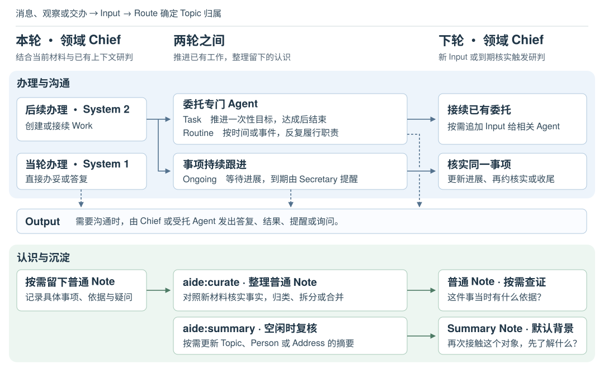

# Personal：理解人，承接目标，持续推进

Personal 是 Aide 的内置个人助手插件。Me 与 Aide 单聊时，[Gate](gate.md) 可以跨 Topic 回答问题，也可以把请求交给负责领域。下图描述领域 Chief 如何处理交办、消息与外部观察。

## 助理身份与授权

Me 是被服务的人。Gate、Chief 和各专属 Agent 都以 Aide 的身份工作，对自己的判断和建议负责。独立助理可以质疑已有判断，也可以被 Me 纠正。了解用户偏好只能帮助提出建议，代表 Me 向他人表态或履行承诺，还需有适用于这件事和这个场合的授权。已有委托范围内可以持续推进。

例如，同事提出做 dashboard，Me 回复「我来弄下」，Aide 随后建议接入诊断工具。这是同事的提议、Me 的承诺和 Aide 的建议。即使 Me 后来采纳诊断建议，也要保留提出者、采纳范围和实际执行者。跨 Topic 归并、摘要和记忆压缩都应保留这些区别。[输入证据](input.md#人物与场合) · [沟通目的地](output.md#地址与收件处)

## 从 Input 到认识与成果

外部发生了什么、涉及谁、发生在哪里，分别由 [Input](input.md)、[Person](person.md) 和 [Address](address.md) 记录。Aide 处理这些材料后，值得复用的事实与方法沉淀为 [Note](note.md)，还要继续推进的事项记为 [Work](work.md)，决定对外表达的内容记为 [Output](output.md)。一条输入可以带来多种结果，也可以读过即止。

[Topic](topic.md) 把相关材料和处理结果串在一起。同一个人或场合可以参与多个主题。外部来源可随 Input 提供稳定的 `topicKey`，Route 据此找到或建立 Topic。Aide 也可以为新事项创建主题，或把相关主题组织到同一个领域。领域 root 的 Chief 结合整个子树里的材料判断下一步。

### 办理与沟通

按响应节奏，办理可以当轮完成，也可以在本轮之后继续。两种节奏由同一个 Chief 判断。

- **当轮响应（System 1）**。现有上下文和当轮工具足以答复或办妥时，Chief 直接处理，需要表达就创建 Output。例如 Me 问「这次审批有结果了吗」，已有审批回执就可以当轮回答。
- **后续处理（System 2）**。这轮结束后还有责任要承担时，Chief 判断下一步是推进一个目标、履行反复发生的职责，还是等具体事项有了进展再核实。一次即时答复也可以伴随后续安排。

#### 后续处理的三种责任

以审批为例，补齐材料并提交是 Task，每周汇总审批是 Routine，持续跟进这一次审批直至有结论是 Ongoing。Chief 先查现有工作，再决定追加材料或创建 Work。三者的查询工具、执行者和收尾条件见 [Work](work.md)。

### 认识与沉淀

Chief 优先处理 Input，遇到值得留存的事实或方法时可顺手记为普通 Note 草稿，保留证据、适用范围与不确定性。拿不准 nature 时留待 curate 核对归类。需要持续跟进的承诺由 Work 承接。事后复盘时，Chief 对照来源和已有 Work 检查历史 Note 中的承诺是否仍然有效，再按需补齐责任。不同知识可以拆分，重复内容可以合并，披露范围随证据复核。具体契约见[梳理与提炼](note.md#梳理与提炼)和[披露边界](disclosure.md)。

#### 有界认识与近期依据

Chief 空闲时，Secretary 安排 `aide:summary` 复核一个 Topic、Person 或 Address。下次接触这个主题、人物或场合时，哪些认识值得默认读到？已有判断是否仍然成立？能跨事项使用、证据充分的结论才写入该对象的 Summary Note，过时的判断随之修订。从一次事项经历推导长期判断时，先核实其结果与适用范围。Task 和 Routine 各自维护本工作的摘要。对象视角与读取契约见[作为 summary 的 Note](note.md#作为-summary-的-note)。

普通 Note 供后续判断按需查阅，Summary 提供紧凑的默认背景。Topic tree 决定哪些材料值得放在一起理解。`aide:organize` 在主题范围变化时调整树结构和材料归属，之后复核摘要时按当前范围判断。见[Topic 的材料归属与处理责任](topic.md#材料归属与处理责任)。

### 跟进未完结的事项

收到「材料已提交，预计周五有答复」时，Chief 可创建 Ongoing。Secretary 到期递交提醒，领域 Chief 查证后更新同一事项。后续可以多次核实，直到有明确结论。[核实与收尾](work.md#核实与收尾)

## 主动性与上下文

同一条 Pod 重启通知可能值得不同处理。Route 先把它归入对应服务的 Topic。若已有排查 OOM 的 Task，Chief 将这条 Input 作为新证据追加给它；若只是已知的例行重启，读过即可。原始 Input 保留来源，Work 保存推进目标所需的材料与进展。

## 对象与主流程

| 流程 | 负责的角色与对象 |
| --- | --- |
| 接收与归位 | [Route](route.md) 确定 Input 的 Topic。[Secretary](secretary.md) 将适合一起处理的 Deferred Input 组成 [Batch](input.md#batch)。 |
| 处理与沟通 | [Gate](gate.md) 承接 Me 的跨领域请求。[Chief](chief.md) 处理领域输入，按需沟通、安排 Work 或留下 Note 草稿。 |
| 主题整理 | [Weave](weave.md) 组织相关领域。[Topic](topic.md) 保存父子关系，每个领域 root 的 Chief 处理其子树。 |

## 角色与协作

各角色通过持久资源协作。运行时确认单条 Input 或 Batch 进入 Chief 上下文后保存投递回执。Task 和 Routine 的受托 Agent 通过 `report_work` 确认实际办理的材料。需要对外沟通时，`say` 创建 Output，投递器保存发送结果。[输入回执](input.md#路由投递与办理) · [执行机制](../harness/README.md#agent-的使用方式与持续职责)

## 资源状态与组件协作

各组件围绕持久资源协作，将负责环节的处理时间、去向、结论及异常写入状态。Input 的 route、assess、handle 分别记录路由、投递和办理；详细执行轨迹、工作目标与进展、输出正文分别由执行记录、Work 和 Output 承载。每个对象的字段、版本、维护者与生命周期在其专属文档中展开；通用并发、Conditions 和版本演进见 [Resource](../plugin/resource.md)。

Ongoing 的主题直接记在 `spec.topic`。其它资源共享的字段如下。

| 共享片段 | 适用对象与边界 |
| --- | --- |
| status.topic | Input、Task、Routine 的唯一当前 Topic UID 引用；Topic 使用 spec.parentRef 表达父子关系 |
| summary / Note | 对象的长期认识与独立的事实、方法；recent 为查询视图 |
| agent / execution | Topic、Task、Routine、Route、Weave 的原生会话与执行；Input 只在处理回执中引用执行 |
| organization | Input、Task、Routine、Topic 最近一次组织调整的操作者、原因、时间和前后关系 |
| conditions | Input、Task、Routine、Topic 按各自业务语义声明条件；不强求同一组状态判断 |

Personal 在 plugins/personal/conditions.ts 实现条件更新规则，在 status.ts 构造自身负责的事实与条件；使用现有 ResourceClient 提交，不让 Host 理解 Personal 的业务语义。Work DTO 的 status、nextAt、question、revision 是展示投影，CRD 分别保存暂停期望、等待、执行和业务结果，以 metadata.generation 表达 spec 修订。

各对象文档按“整体定位、CRD（如有）、Reconciler（如有）、Agent（如有）”组织。Agent 下的 Context View 是文本形式的 prompt 大纲，说明 system 和 user 各由哪些部分构成，以发现重复、过期、缺失或越界的上下文。它与执行历史的 SessionView、单次业务证据的 JobView 分工不同；实际请求仍以录制证据为准。

## 运行与验证

Personal 的资源定义与 Controller 经普通 Plugin 契约注册；Source、Route、Topic、Task 和 Routine 各自协调资源，Person 共享目录按需读写。Controller 之间通过资源变更与索引协作，依据持久回执判断业务完成状态。

框架机制见 [Plugin](../plugin/README.md)，原生执行边界见 [Harness](../harness/README.md)，外部接入见 [Connector 与 Source](../connector/README.md)。配置阈值集中在 [配置](../configuration.md)，真实模型和平台效果按 [E2E](../e2e.md) 验收。各主题文档链接相应自动测试；替身测试不证明真实提供方连通或模型判断质量。
