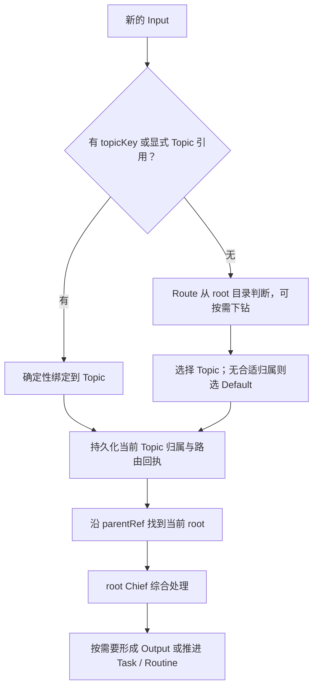

# Topic：主题组织与生命周期

## 定位与角色关系

Topic 保存主题的长期认识、材料与工作的归属，以及主题之间的父子关系。Topic tree 表达 Aide 当前如何理解和组织用户关注的事情：哪些问题值得共同理解，哪些需要独立跟进，以及局部认识如何汇入更广的主题。本文维护资源模型、归属交接、认识依赖和生命周期契约；完整角色流转见 [Personal](README.md#角色与协作)。

| 角色 | 与 Topic 的关系 |
| --- | --- |
| Route | 为 Input 确定初始 Topic 归属 |
| Chief | 处理当前 root 的 Input／Batch，维护责任树内的认识、材料与工作归属 |
| Secretary | 观察 Topic 及处理事实，准备 Batch 和 Curate／Followup／Organize Input |
| Weave | 根据主题关联价值调整领域 root 之间的组织关系 |
| Task／Routine | 在所属 Topic 内承担有限目标或持续职责，独立执行和确认办理结果 |

一个领域 root 对应一个 Chief，子 Topic 由当前 root Chief 维护。Chief 和 Secretary 是独立的 Reconciler，持久状态由 Topic 承载。Immediate／Normal Input 直接交给 Chief；Secretary 旁观资源事实并准备后续工作。接纳、执行与工具见 [Chief](chief.md#reconciler)，维护调度见 [Secretary](secretary.md#reconciler)。

主题组织以材料能否共同解释问题、职责是否清楚和长期认识是否有助于判断为依据。树内下沉不会自动减少 root Chief 的总责任；成为独立 root 才改变处理边界。root 数量的软目标与全局归组判断见 [Weave](weave.md)。

## CRD

类型为 `aide.dev/v1alpha5 Topic`。完整字段见[模型](../../plugins/personal/topic/model.ts)。

### Topic 身份与树结构

Topic 使用独立 ID / UID，名称和来源 key 不充当资源身份。字段位于 Topic.spec 和 Topic.status：

| 信息 | 契约 |
| --- | --- |
| spec.name | 便于理解的主题名称，可以变化 |
| spec.topicKey | 可选的来源关联键；一个 key 同时只对应一个可接纳的 Topic |
| spec.parentRef | 固定到 UID 的父 Topic 引用；Gate 无父，领域 root 指向 Gate |
| status.summaryRevision | 摘要 Note 的派生内容指纹；通过 Note.summaryOf 索引读取正文，recent 从普通 Note 的 subject 索引查询 |
| status.lastInputAt | 本 Topic 及其子树已观察到的最后一次业务 Input 时间；子节点活动异步向上传播 |
| spec.default | 系统兜底主题标记，与保留身份 `default` 一致，不可转移 |
| status.agent / status.execution | root 的原生会话引用和执行状态；非 root 不继续运行 Chief |

只持久化 parentRef，不再持久化 children 列表。按 parentRef 索引反向查询直接子节点，沿 parentRef 向上寻找领域 root（Gate 的直接子节点），执行和知识整理不越过这个边界；API / Web 可以返回由此生成的树投影。

- Gate 是唯一没有 parentRef 的 Topic；领域 root 的 parentRef 指向 Gate。
- 没有 children 的 Topic 是 leaf。
- 按 topicKey 新建的 Topic 同时是 root 和 leaf。
- 一个 Topic 最多一个父节点，父引用不能形成环或跨向已删除的实例。
- Weave 生成的父 Topic 不复制子节点的 topicKey；来源 key 仍指向原来的 Topic。

Default 是系统兜底 root，始终直接挂在 Gate 下；详细约束见[默认主题](#默认主题)。

### Spec

id 保存业务标识；name、topicKey、parentRef、default 表达展示、来源关联和树结构；review 控制是否启用后台回顾，结构通知和容量维护仍独立协调，address 保存可选的来源地址，不能由父子关系推导外发目的地。

### Status

| 字段 | 含义与维护者 |
| --- | --- |
| weaveRevision / notifiedWeaveRevision | 结构调整与 Chief 通知进度 |
| chiefWorkload | Chief 完成量、Review 覆盖水位及未回顾活动的最早时间；Batch 计一次 |
| maintenanceRequests | Secretary 保存每种维护 origin 的请求身份、需求指纹和尝试次数，用于去重与退避 |
| reviewCheckedAt / idleSince | Secretary 最近回顾检查时间 / Chief 最近执行完成时间 |
| idleReviewCount | Secretary 连续无事可做的静默检查次数，缺省为 0 |
| idleReviewReset | 本轮空闲期首次观察到业务输入的时间与重置前次数；检查完成或责任边界重置时清除 |
| organization | Chief 或 Weave 最近一次组织调整的原因和前后关系 |
| lastError / receipts | 执行异常与幂等请求回执 |

### 默认主题

Default Topic 承接规则与 Route agent 无法明确归属的输入。主动联系 Me 由 Default Channel 决定，与默认主题独立。

Default 由系统维护，Route 首次需要兜底时自动创建，后续输入与服务重启均复用同一资源。创建时通过专用索引检查本插件内的唯一性；保留身份不可变，后续状态更新不重复查询全部 Topic。`default` 是保留身份；并发创建只产生一个 Default，不将已有业务 Topic 提升为默认。Web 保留默认标记和列表置顶，不提供设置、切换或取消 Default 的操作，也不提供对应 API。

Default 保持系统兜底 root，不参与 Weave、不能挂到其他 Topic 下，也不能删除。它可以通过与普通 root 相同的组织机制建立 children，让暂存材料逐步下沉。它不绑定来源地址或 topicKey，不自动启用定时回顾，不授予通信或执行权限。用户仍可在其中交流和开启回顾；给 Me 发通知使用 Default Channel。

## 材料归属与处理责任

### TopicLocator 能力

Channel / Source 复用 [TopicLocator](../../plugins/personal/topic/locator.ts) 领域契约，具体定位规则留在各自适配器中，而不是共同继承一套通信或观察生命周期：

```ts
type TopicSelector =
  | { kind: "id"; id: string }
  | { kind: "key"; key: string };

interface TopicLocation {
  selector: TopicSelector;
  name?: string;
}

interface TopicLocator<T> {
  locate(input: T): TopicLocation | undefined;
}
```

具体适配器针对已经解析的消息实现或组合这个能力，生成 Input 时将 selector 写入 topicId 或 topicKey，将可选 name 写入 topicName。ID 和 key 都是精确定位：前者指定 Topic 身份，后者指定稳定来源归属。未来可以增加泛化或模糊特征，由 Route 解释并决定归属；当前不实现这些变体，也不把模糊特征编码成精确 key。现有身份与展示 Definition 不因此承担协议解析职责。方法同步、确定性、无副作用；不调用模型、不创建 Topic，无明确规则时返回 undefined。

name 是来源提供的建议名称，不参与定位或身份匹配。Route 新建 Topic 时优先使用 Input.topicName，缺失时取首条正文简述；名称合并空白并限制为 80 字符。后续 Input 不覆盖既有名称，也不重命名 Weave 父主题。已存在的正文预览名称保留，不通过重复投递批量改名。

Connector 返回群名等平台事实，Channel / Source 在定位前准备这些事实，locate 本身仍不做 I/O。来源名称保留在 Input 的 observation 中；Topic.spec.name 及 Input 预览共同为 Web 和 Agent 提供可读背景。名称获取失败只影响展示，不阻止原消息接纳。

key 的作用域包含必要的平台和账号信息，避免无关来源碰撞。来源相同的 Channel 与 Source 使用同一规则，不能仅因入口类型不同就拆开。示例沿用 [Lark 的来源划分](../connector/lark-messages.md#topic-创建与归属)：

| 来源 | topicKey |
| --- | --- |
| Lark 单聊，或没有 threadId 的群消息 | `lark:<appId>:<chatId>` |
| Lark 群话题 | `lark:<appId>:<chatId>:thread:<threadId>` |
| EnvironmentSource，同一环境的所有 namespace | `environment:<规范环境名>` |
| Forge，同一仓库的所有 PR/MR | `forge:["<forge.name>","<repository.path>"]` |

userId、发送人和单条 messageId 不参与该规则。正文相似程度由 Weave 判断，不进入来源 key。Web 显式选择已有 Topic 时可以直接提交目标引用，无需重新猜测来源归属。

业务 Input 的 sessionId 语义由 topicKey 承接；Harness 的原生 sessionId 保持独立。来源归属、资源 UID、通信 Address 和原生 Agent 会话是四种不同身份。

### Input 归属与 root 处理

Input 保留可选 topicKey、status.topic 中的当前 Topic 引用，以及实际处理它的 execution / 回执。原始事实和来源证据只保存一次。Weave 挂载父子关系保留材料归属；Chief 可以在树内调整归属，已完成输入不重新消费。



入站先执行已有 Input 身份去重。对真正的新输入，有 key 就复用可接纳 Topic，没有则创建；Topic 创建、key 唯一性与绑定需要覆盖并发接纳。旧 Input 的重复投递不能在原 Topic 被回收后重新创建 Topic 或触发处理。

有明确 key 的输入通常挂在来源 leaf，Chief 可以在处理后细化这一归属。有明确路由规则的 Input 初始挂到目标 Topic；没有明确规则的输入由 Route 选择当前 root。Route 背景只有 root 候选及其有界概况，不会把全部 leaf 目录常驻到模型上下文。

Chief 只在 root 启动新执行；运行中的 Topic 成为子节点后，旧 Chief 可以自然完成。子树的 Input 作为这个 root 的材料，中间节点不逐层启动 Agent。一次 Output 可以综合多个 leaf 的输入，重复、无新增价值的事实可以静默吸收；紧迫性、来源关系和主题归属本身不构成执行授权。

每个 Input 只有一个当前 Topic 归属。跨主题引用展示与实际消费分开；树结构和归属变化都不重置全局研判回执。

一个 root Topic 对应一个 Chief，常规读取范围是该 root 的整棵 Topic 子树。宿主和 Runner 从当前 Topic 出发，按 parent UID 索引逐层读取子节点，直到没有下一层；这是父节点先于子节点的拓扑排序，以广度优先遍历实现。按需的材料、Work 与认识查询限定在所得子树内，不先枚举全局 Topic。Weave 修改父子关系后，下次读取自然反映新的子树，Input 和 Work 的原始归属不变。

### 归属调整与责任交接

Input、Task、Routine 均通过 `status.topic` 保存唯一的当前 Topic 归属，引用固定到 UID。原始事实、来源和首次路由记录保留，当前归属可以调整。Input 的 `status.route` 只记录 Route 的处理结果；Work 的 spec 保存目标与调度定义。数据模型、查询索引和工具范围共同表达这一归属，迁移后的读取与执行使用一致的责任边界。

迁移保留 Input / Work 的身份、研判与办理回执、工作目标和 Routine 调度。已完成的处理不会因归属变化重新执行。移动正在执行的工作，或把子树从一个 Chief 交给另一个 Chief，需要明确安全交接点，并以资源版本和接纳记录防止重复处理。

工具表达移动 Input、移动 Work 和调整 Topic 父子关系，接口边界由资源范围与事务约束决定。

Chief 用 `list_inputs` 分页发现已处理材料，通过 `create_topic`、`move_topic` 调整树结构，用 `move_input`、`move_work`、`move_note` 调整材料归属；move_topic 的 parentUid=null 表示独立子树。迁移保留身份与处理回执，记录操作者、原因、时间与前后归属；Chief 写入的 organization 同时记录 executionId，供提交时核验当前执行。事务内通过 UID 和索引读取校验当前 Chief execution、真实祖先链、无环约束及待移动子树的在途工作；只写实际变化的资源，不给整棵树空写版本栅栏。子树仍有执行或 Input 接纳时，移动等待完成；同一事务推进原 root 的结构版本，阻止按旧树快照准备的后续接纳，并通知 Chief 重读责任范围。新 root 由自身 Reconcile 接管 Chief，Weave 读取拆分原因并保留观察间隔。

### 组织调整的稳定性

Chief 拆分时留下原因和所依据的主题状态，Weave 归拢时读取这些依据。主题独立性和共同理解价值是双方共享的判断标准；root 数量压力不能单独推翻语义边界。

结构调整后留出观察间隔；没有新证据时，避免立即反向调整。同一状态已经回顾且决定不调整，应记录理由与检查版本，并按间隔重查。新材料、认识变化或新的组织压力可以让旧判断重新进入检查。

## 主题认识与汇总

### 父子 Topic 的认识

Topic 的长期 summary 与近期事项均保存为独立 Note；Topic 记录自身摘要的内容指纹。子 Topic 没有独立 Chief，局部认识由当前 root Chief 维护。父 Topic 按需综合子主题，保留来源、分歧、作者和授权边界；已有层级的综合认识也可以供后续 root 阅读。

Chief 处理一条 Input 时，可能留下对某个事项的初步记录。随着更多材料到来，`aide:curate` 核实、归类和整合普通 Note，让同一事项的依据与进展可以持续查阅。若某项结论超出原事项仍然成立，`aide:summary` 再判断它是否值得成为下次接触该 Topic 时默认读到的背景。许多事项在普通 Note 中就有了完整记录。

父子 Topic 按各自的职责范围保存认识。`aide:organize` 调整 Topic 和材料归属。下次复核该 Topic 的 Summary 时，Chief 按当前范围重新审视已有判断。

新建父 Topic 保留子 Note 的原始 subject，综合时创建自己的 Note。认识维护的工具、按需读取和上下文预算见 [Chief](chief.md#上下文与记忆)，Note 本身的存储及引用契约见 [Note](note.md)。

### 汇总调谐

每个 Topic 的 activity Controller 观察直属子节点的业务活动，将 lastInputAt 逐级传给父节点。

汇总不调用 Agent，也不是 root 处理 Input 的前置步骤。Chief Reconcile 仅在领域 root 上启动或复用 Chief；秘书观察汇总事实，独立安排维护请求。

活动调谐只更新当前 Topic。NeedsAttention 跟随 Chief 执行异常更新，见 [Conditions](../plugin/resource.md#conditions-契约)。


## 生命周期

### 回收资格

Chief 的[静默会话释放](chief.md#会话释放)保留 Topic 的认识和树结构；资源数量和字节容量由 Resource 底座管理：

```yaml
resources:
  kinds:
    aide.dev/Topic:
      maxCount: 1000
      order: released
```

容量压力下，按最后一次 Input 时间从早到晚检查候选；没有 Input 时使用创建时间。父节点包含子树的业务活跃度，整理、摘要、回顾与读取不刷新这个时间。底座 released 排序复用该业务时间，低水位与容量错误遵循 [Resource 容量](../plugin/resource.md#resource-容量与释放)。

Topic 在实际淘汰事务内核验资格：Default、执行中或尚持有会话、有异常、有子节点、待处理 Input 或 Work 的对象受到保护。普通叶子 Topic 无认识与 Note 时可作为候选；有认识时，由 Chief 读取当前 reclamationVersion，通过 release_topic 明确记录知识可舍弃或已安全保留的理由。该版本覆盖完整 Note 集合，内容和归属变化使原判断失效。

没有安全候选时，底座拒绝超出容量的写入。容量淘汰直接删除记录和索引，并在事务提交后发布删除事件；候选必须先释放会话。显式删除仍使用标准删除生命周期与原有依赖校验。

回收后来源 key 可以被新 Topic 使用，新实例有新 UID。历史 Input、Output 和独立 Note 保留原引用；不根据相同 key 自动继承旧实例的关系或知识。

### 删除与验证

Topic 删除的事务校验只读取 parent、assessPending、Work topic 索引命中的当前关联对象，并检查子 Topic 当前知识版本的释放许可；历史 Input 和无关 Topic / Work 不进入校验查询。事务内新增的子节点或在途 Input 仍会阻止删除。

显式删除在存储事务内校验 Default、子节点、执行、未完成 Input、相关 Work 和子 Topic 的知识释放许可。删除请求使用 UID 与资源版本作为前置条件。历史 Input/Output 可引用已消失的 Topic，不根据同名或同 key 猜测替代实例。

[Weave 场景](../../tests/weave.test.ts)、[接纳](../../tests/topic-intake.test.ts)、[定时回顾](../../tests/topic-review.test.ts)、[默认主题](../../tests/default-topic.test.ts)和[删除](../../tests/topic-delete.test.ts)覆盖生命周期；[Pi 场景](../../tests/pi-agent.test.ts)覆盖原生连续执行。模拟测试不证明真实主题整理质量。

## 展示与验证

### Output、界面与追踪

多个来源共用处理上下文时，Output 使用明确的 Input 地址或指定 target；主题父子关系不推导通信地址、不继承新的外发授权。Default 的兜底归属也不等于通用外发目的地。研判完成、目标达成和 Output 送达继续分别记录。

Web 的 Topics 入口默认分页展示 root，可用父主题 ID 过滤其直接子主题；分页契约见 [Web](../channel/web.md#会话导航)。Input 详情分别展示来源 topicKey、稳定挂载 Topic、实际处理 root 和执行记录；历史 Topic 已删除时显示这一事实，不自动跳转到同 key 的新 Topic。

Weave 记录候选 UID、新父 UID、组织理由、分组时的知识版本与交接结果；回收记录静默依据、删除阶段及受阻原因。一次 Input 能追踪到处理和输出，一次综合认识能回查来源证据，避免因整理丢失来路。

### 验收

底座提供通用资源、事务和 Harness 能力，主题判断与归属契约由 Personal 负责。

| 验收场景 | 必须成立的结果 |
| --- | --- |
| 同 key 并发接纳、进程重启、重复投递 | 只绑定一个可接纳 Topic；原 Input 不重新执行 |
| 有 key 与无 key 的输入 | 前者确定性绑定；后者只选择当前 root，无合适归属进入 Default |
| 多个 Topic 建立共同父节点 | 只持久化 parentRef，无环、无双父，Input 原归属不变 |
| 分组与输入、执行、重启并发 | Weave 保留材料归属，旧 Chief 可完成，新 root 由 Reconcile 通知 |
| 跨 leaf 的连续输入 | root Chief 形成综合认识，支持合并输出或静默处理 |
| 子主题认识更新 | 独立保留来源，维护 Input 按需修订父摘要 |
| Default 参与分组或删除 | 操作被拒绝，Default 始终独立存活 |
| 活跃子树、静默 leaf、未完成工作 | 活跃父节点不误删；静默叶子满足交接条件后回收 |
| 删除与新输入并发、同 key 再出现 | 新实例独立，旧引用不被替换，key 不隐式转交父节点 |
| 大量 root / leaf 以及不断加深的树 | 上下文与每轮整理开销受预算约束，不全量展开 |
| 多来源输出 | 按明确 target 投递，主题组织不导致错误群聊外发 |

观察指标包括 root / leaf 数量与静默回收量、每轮模型输入量和调用次数、Weave 检查与有效组织次数、Input 到有效 Output 的收敛程度、重复提醒率及重要信息遗漏。功能测试通过不等于真实模型已经获得预期的信息整理效果，需以真实输入轨迹另行验收。

[状态测试](../../tests/status.test.ts)覆盖 子 Topic 的业务活动向祖先传播；[归属测试](../../tests/topic-ownership.test.ts)覆盖大树整理、祖先变化、在途接纳与并发成环。
