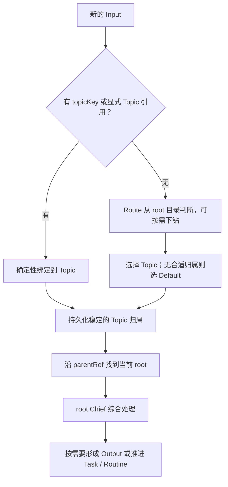
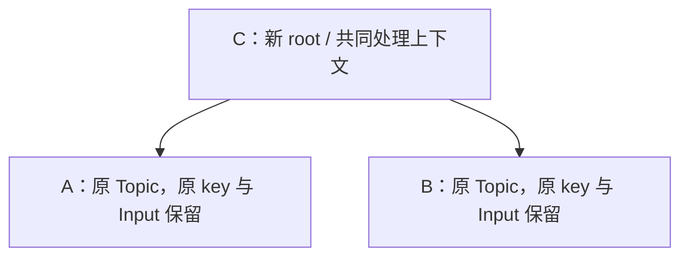

# Topic 与 Weave：从分散输入到综合认识

Topic 是 Personal 的业务对象；Weave 负责组织主题关系。本文是当前模型和生命周期契约，运行效果仍须用真实输入轨迹验证。

## 目标与职责

大量 Input 从不同 Channel 和 Source 涌入时，逐条回复会放大噪声；每个外部聊天或 thread 长期独占一个处理上下文，又会让同一主题的线索分散。Topic 先保存稳定的来源归属，再通过主题之间的组织，让相关输入在共同上下文中形成认识。

Weave 将不同来源、领域的相关知识组织到共同上下文，促进认识融合，同时收敛 root 与独立 Chief 的处理规模。双重目标、分组判断和成本衡量见 [Weave](weave.md)；本文展开 Topic 树、处理责任交接与回收契约。

| 对象或组件 | 职责 |
| --- | --- |
| Channel / Source | 接纳或观察事实，按明确规则提供可选 topicKey |
| Topic | 保存主题认识、来源关联及主题之间的关系 |
| Route | 完成 Input 的 Topic 归属；有 key 走确定性规则，无 key 才做语义判断 |
| Weave | 整理 Topic 之间的关系，把值得共同理解的主题组织起来 |
| Chief | 在 root Topic 上综合子树输入，处理委托并决定是否产生 Output |
| Task / Routine | 继续承担有限目标与持续职责，拥有独立执行和办理回执 |

目标是把成百上千条输入收敛为少量有价值的输出。输出数量降低一个数量级是效果观察目标，不是强制配额；重要变化不能因压缩数量而漏报。主题数、处理上下文数和输出数分别衡量。

## Topic 身份与树结构

Topic 使用独立 ID / UID，名称和来源 key 不充当资源身份。字段位于 Topic.spec 和 Topic.status：

| 信息 | 契约 |
| --- | --- |
| name | 便于理解的主题名称，可以变化 |
| topicKey | 可选的来源关联键；一个 key 同时只对应一个可接纳的 Topic |
| parentRef | 可选的父 Topic 引用，固定到 UID |
| summary / recent | 累计认识与有界的近期依据 |
| lastInputAt | 本 Topic 及其子树最后一次接纳新 Input 的时间 |
| default | 系统兜底主题标记，与保留身份 `default` 一致，不可转移 |
| status.agent / status.execution | root 的原生会话引用和执行状态；非 root 不继续运行 Chief |

只持久化 parentRef，不再持久化 children 列表。按 parentRef 索引反向查询直接子节点，沿 parentRef 向上寻找 root；API / Web 可以返回由此生成的树投影。

- 没有 parent 的 Topic 是 root。
- 没有 children 的 Topic 是 leaf。
- 按 topicKey 新建的 Topic 同时是 root 和 leaf。
- 一个 Topic 最多一个父节点，父引用不能形成环或跨向已删除的实例。
- Weave 生成的父 Topic 不复制子节点的 topicKey；来源 key 仍指向原来的 Topic。

Default 是永久、独立的 root。它承接无合适归属的输入，不参与 Weave 分组，不被挂到其他 Topic 下，也不作为分组父节点接纳其他 Topic；不允许删除或静默回收。该例外不授予额外执行或外发权限。

## TopicLocator 能力

Channel / Source 复用 [TopicLocator](../../plugins/personal/topic/locator.ts) 领域契约，具体定位规则留在各自适配器中，而不是共同继承一套通信或观察生命周期：

```ts
type TopicSelector =
  | { kind: "id"; id: string }
  | { kind: "key"; key: string };

interface TopicLocator<T> {
  locate(input: T): TopicSelector | undefined;
}
```

具体适配器针对已经解析的消息实现或组合这个能力，生成 Input 时将结果写入 topicId 或 topicKey。ID 和 key 都是精确定位：前者指定 Topic 身份，后者指定稳定来源归属。未来可以增加泛化或模糊特征，由 Route 解释并决定归属；当前不实现这些变体，也不把模糊特征编码成精确 key。现有身份与展示 Definition 不因此承担协议解析职责。方法同步、确定性、无副作用；不调用模型、不创建 Topic，无明确规则时返回 undefined。

key 的作用域包含必要的平台和账号信息，避免无关来源碰撞。来源相同的 Channel 与 Source 使用同一规则，不能仅因入口类型不同就拆开。示例沿用 [Lark 的来源划分](../connector/lark-messages.md#topic-创建与归属)：

| 来源 | topicKey |
| --- | --- |
| Lark 单聊，或没有 threadId 的群消息 | `lark:<appId>:<chatId>` |
| Lark 群话题 | `lark:<appId>:<chatId>:thread:<threadId>` |

userId、发送人和单条 messageId 不参与该规则。正文相似程度由 Weave 判断，不进入来源 key。Web 显式选择已有 Topic 时可以直接提交目标引用，无需重新猜测来源归属。

业务 Input 的 sessionId 语义由 topicKey 承接；Harness 的原生 sessionId 保持独立。来源归属、资源 UID、通信 Address 和原生 Agent 会话是四种不同身份。

## Input 归属与 root 处理

Input 保留可选 topicKey、确定后的 Topic 引用，以及实际处理它的 root / execution / 回执。原始事实和来源证据只保存一次。归属一旦确定，不因 Weave 重新挂载到父节点，也不因树结构变化重新消费已完成输入。



入站先执行已有 Input 身份去重。对真正的新输入，有 key 就复用可接纳 Topic，没有则创建；Topic 创建、key 唯一性与绑定需要覆盖并发接纳。旧 Input 的重复投递不能在原 Topic 被回收后重新创建 Topic 或触发处理。

有明确 key 的输入通常挂在来源 leaf，之后一直保留这一归属。没有明确 key 的输入由 Route 选择，目标可以是 root 或子 Topic。Route 默认背景只有 root 候选及其有界概况，必要时查询具体子主题；不会把全部 leaf 目录常驻到模型上下文。

Chief 只在 root 运行。子树中新到的 Input 由这个 root 接纳，中间节点不逐层启动 Agent。一次 Output 可以综合多个 leaf 的输入，重复、无新增价值的事实可以静默吸收；紧迫性、来源关系和主题归属本身不构成执行授权。

默认只确定一个 Topic 归属。现有跨 Topic fanout 不能机械复制到树的每一层：共同祖先不能因此重复研判同一 Input。若保留跨主题引用，引用展示与实际消费必须分开。

## 认识积累与上下文预算

root Chief 可维护来源 Topic 的局部认识和 root 的综合认识。子节点没有独立 Chief，不意味着局部 summary 无人维护。已有层级中的综合认识也可以作为后续 root 的阅读材料。

沿用当前 [认识与回执分离](#研判与上下文) 的约定：assess 记录单次处理事实，summary / recent 在出现有意义的新认识时更新；静默完成一条 Input 不要求追加一条重复摘要。

父 Topic 逐步吸收子 Topic 的 summary 和必要证据，不机械拼接全文。吸收过程保留来源、分歧、未决问题，并记录已吸收的子认识版本；同一版本不会被反复追加，版本变化后可以继续吸收。

每次模型请求的 Background 只加载有界材料：

- Route：root 候选概况，详细主题按需查询；不要求遍历所有 leaf。
- Chief：root 综合认识、有界近期依据、子主题概况和相关工作；详情按需读取。
- Weave：按静默时间排序的一批 root 及通过搜索发现的少量候选，选中后再读取必要证据。

原生会话通过 Harness 支持的方式初始化、持久化与恢复。新父 Topic 的 Chief 读取子主题认识，不拼接、改写子 Chief 的原生会话文件，不重放已完成的输入。模型请求前的业务背景继续使用 [Background](../harness/pi.md#当前业务背景) 通道。

子主题认识变化唤醒当前 root；无新 Input 时仍核对未吸收版本，并由现有 Chief 自底向上吸收。吸收尝试间隔至少 60 秒，无进展时逐步退避至 15 分钟，等待和重启不会伪造 Input 或刷新活跃时间。启动时最多合批接纳 8 条积压 Input，紧迫输入优先且无额外等待窗口；每条保留独立回执，运行中新消息继续通过 steer / followUp 接纳。

树结构本身不保证模型负担下降。root 数量、背景字符数、按需读取量与模型调用频率都需要预算；突发的普通输入可合批处理，不把每次资源变化都变成一次模型调用。

## Weave：主题整理

目标与效果衡量见 [Weave：知识融合与处理上下文收敛](weave.md)。

组件、目录和配置统一使用 weave，与 route 的动词命名保持一致。Weave 属于 Personal：模型判断主题关系，Operator 执行有边界、可核对的资源修改。它不代替 Chief 研判输入、创建工作或对外回复。

### 当前操作：建立共同父主题

对两个或多个值得共同维护上下文的 root，创建一个新的父 Topic，并将它们挂在下面：



可继续将 C 与另一个 root D 组织到新父 E 下。该操作可以称为 group_topics；它只是 Weave 当前支持的动作，不能将 weave 本身等同于固定的建树函数。

一次分组减少 root 数量，但会新增一个总节点。Weave 收敛独立处理上下文，静默回收控制保留节点的规模，两者共同承担容量治理。

候选必须是存活、可交接、非 Default 的 root。语义相似只是线索，判断标准是这些主题是否值得由同一个 Chief 持续维护共同认识。不能为了降低数量，将没有合理共同主题的内容强行归组。

### 两种触发

| 触发 | 处理方式 |
| --- | --- |
| root 数量超过阈值 | 从最久没有新 Input 的 root 开始，寻找适合共同组织的主题 |
| 周期整理 | 按批轮转检查 root，目录或认识变化后重新检查，整理同类主题 |

静默决定优先检查顺序，不直接证明主题相关。无合适候选就跳过；没有新证据的候选组合不反复判断。每轮限制检查数、组合数和模型预算，避免全量两两比较。默认 rootThreshold=20、intervalMs=300000、batchSize=12；达到阈值且目录变化时提前整理，两次调用至少间隔 min(30000, intervalMs)。每轮最多分组一次、每组 2–8 个 root。目录指纹使用身份、名称和认识版本；一轮分页扫描结束后，未变化的目录不继续调用模型。Controller 将实际候选快照注入本轮提示词；按实际展示数量推进游标，字符预算截断不会跳过候选。成功结束且目录未变化才确认覆盖；失败保留批次，指纹或排序变化重新从头扫描。

### 处理责任交接

分组必须同时解决拓扑修改与执行交接，不能只写 parentRef：

1. 核对候选的 UID、版本、root 身份、Default 标记及删除状态，准备新父的综合认识。
2. 暂停旧 root 接纳新的 Chief 执行；输入仍持久化到原 Topic 并等待处理。已有执行完成或经明确恢复流程收尾后再交接，可能有副作用的调用不自动重放。
3. 先建立带 weaveLock 的准备父节点（不进入 Route 候选、不执行 Chief），再在资源事务中更新全部候选的 parentRef；冲突时重新读取，不留下只挂入一部分节点的结果。
4. 在旧根与新父均冻结时，按宿主最多 100 个写入的事务预算分批转移尚未开始的消费和空闲 Task / Routine；完成后才原子切换所有 parentRef 并启用新根。管理责任交给新 root，保留原始 Input 引用及已完成回执，避免同一输入被两个 Chief 同时接纳。仍有执行时等待；未完成且已有 executionId 的不确定副作用阻止本次分组，释放锁供原 Chief 核对。候选认识变化也取消本次计划，等待重新综合。
5. 新 root 恢复接纳，旧 root 的 Chief 释放。阶段进度须可恢复，重试不重复创建父节点或重复消费。

新父在交接完成前处于不可执行的准备状态；拓扑事务提交本身不能提前启动其 Chief，进程重启也必须遵守同一接纳门槛。

拓扑变化后，Route 的既有候选需要在提交时重新核对。无 key 输入仍可挂到已成为子节点的有效 Topic，但处理位置必须解析到当前 root；deleting Topic 不能接收新绑定。

## 静默回收

普通 Topic 默认 7 天没有新 Input 时可以回收，配置为 plugins.personal.topic.idleMs，Default 除外。静默从最后一次接纳新 Input 计算；父节点包含整个子树的活跃度。Weave 创建父节点时继承候选的输入活跃时间，整理、摘要更新、定时检查与 Agent 状态变化都不刷新这个时钟。

回收按自底向上处理，避免删除父节点后留下孤儿。叶子满足静默条件时：

1. 重新核对活跃时间、UID 和版本，以及待处理 Input、执行和关联工作。
2. 有父节点时，确保值得保留的最新认识已经被吸收；相关持续工作已交接。无父节点的普通 root 也可回收，无需永久保留其 Agent 上下文。
3. 前置条件满足后先请求删除，由资源机制设置 deletionTimestamp，停止新输入绑定与新的关系修改。
4. 完成资源清理再 finalize；Input / Output 仍按各自保留策略存在，读取方允许所引用 Topic 已不存在。

删除请求前若新输入已被接纳，版本检查使旧的回收决定失效。key 对应的 Topic 已进入删除时，新输入只能绑定新的可接纳实例；唯一性检查按可接纳对象计算，旧实例的 finalize 不能误删新实例的 key 归属。

删除会移除来源 key 的有效归属，不把 key 转交父 Topic，不留下用于自动路由的别名。历史事实可以保留原 key，但不能作为隐藏映射。之后同 key 真正有新输入，就创建新 ID / UID 的 Topic；它可以依据当时语境被 Weave 组织到另一处。

例：A、B 被组织到 C 下，A 静默并被吸收后删除。此后 key A 再有新消息，创建独立 root A′；它不会直接回到 C。C 保留已吸收的认识，历史 Input 仍引用旧 A。

活跃的子树不能因父节点没有直接 Input 而被回收；待处理输入、执行和工作也不能因 TTL 被丢弃。静默回收控制冷数据增长，不意味着活跃 Topic 数量存在硬上限。

## Output、界面与追踪

多个来源共用处理上下文时，Output 使用明确的 Input 地址或指定 target；主题父子关系不推导通信地址、不继承新的外发授权。Default 的兜底归属也不等于通用外发目的地。研判完成、目标达成和 Output 送达继续分别记录。

Web 的 Topics 入口演进为 Topics，默认展示 root，可展开子主题。Input 详情分别展示来源 topicKey、稳定挂载 Topic、实际处理 root 和执行记录；历史 Topic 已删除时显示这一事实，不自动跳转到同 key 的新 Topic。

Weave 记录候选 UID、新父 UID、组织理由、认识吸收版本与交接结果；回收记录静默依据、删除阶段及受阻原因。一次 Input 能追踪到处理和输出，一次综合认识能回查来源证据，避免因整理丢失来路。

## 落地范围与验收

实现需同步调整 Personal 的 Topic 模型及索引、Input 绑定与消费凭据、Route / Chief 的工具和 Background、Weave 协调与 Agent、Task / Routine 的所属主题处理、Channel / Source 接纳契约、Web 投影及查询 API。底座继续提供通用资源、事务和 Harness 能力，不承担主题判断。

本方案采用目标模型设计，不建设长期并行的 Conversation / Topic 双模型。已有部署状态如何切换须在实施和部署时明确；本次统一迁移覆盖代码、工具、API 与文档；不提供历史状态兼容层。上线时应停服务、清理旧业务状态（包含 channels/ 中的收发记录）后启动新版本。本次代码改动未操作部署环境。

| 验收场景 | 必须成立的结果 |
| --- | --- |
| 同 key 并发接纳、进程重启、重复投递 | 只绑定一个可接纳 Topic；原 Input 不重新执行 |
| 有 key 与无 key 的输入 | 前者确定性绑定；后者可选 root 或子 Topic，无合适归属进入 Default |
| 多个 Topic 建立共同父节点 | 只持久化 parentRef，无环、无双父，Input 原归属不变 |
| 分组与输入、执行、重启并发 | 处理责任明确，交接可恢复，无遗漏和重复副作用 |
| 跨 leaf 的连续输入 | root Chief 形成综合认识，支持合并输出或静默处理 |
| 子主题认识更新与重复吸收 | 最新证据可追溯，已吸收版本不重复堆积 |
| Default 参与分组或删除 | 操作被拒绝，Default 始终独立存活 |
| 活跃子树、静默 leaf、未完成工作 | 活跃父节点不误删；静默叶子满足交接条件后回收 |
| 删除与新输入并发、同 key 再出现 | 新实例独立，旧引用不被替换，key 不隐式转交父节点 |
| 大量 root / leaf 以及不断加深的树 | 上下文与每轮整理开销受预算约束，不全量展开 |
| 多来源输出 | 按明确 target 投递，主题组织不导致错误群聊外发 |

观察指标包括 root / leaf 数量与静默回收量、每轮模型输入量和调用次数、Weave 检查与有效组织次数、Input 到有效 Output 的收敛程度、重复提醒率及重要信息遗漏。功能测试通过不等于真实模型已经获得预期的信息整理效果，需以真实输入轨迹另行验收。


## 接纳与连续执行

Topic 的接收 Controller 查询 Input.assessPending，具名 agent Controller 驱动根 Chief。空闲时 prompt，运行中 deferred Input 使用 followUp，immediate 使用 steer；原生接纳前持久化 executionId。Channel 的显式 Topic 规则在 Input 持久化和去重之后完成，避免先建空主题或被重投复活。

明确拒绝 steer 时释放该次接纳；结果未知保留证据。status.agent 只保存 harness 和原生 sessionId，恢复由 SDK 承担。成为子节点后释放 Chief 原生句柄，不修改旧历史。

## 研判与上下文

assess_input 只保存单次研判回执（最多 1000 字符）并原子交接 Work。summarize_topic 更新累计认识，可选 recent；topicUid 可指定根内的子主题，absorbed 使用直接子主题的 understandingVersion。必须先 read_topic，提交时校验根执行、目标资源版本和子认识版本；过期综合需重读。根的无参 read_input 仍提供当前上下文和版本。

summaryChars 默认 4000、最高 16000；contextChars 默认 48000。近期依据仍受统一数量和字符预算约束。详情见[配置](../configuration.md#topic-消费策略)。

## 默认主题

Default Topic 承接规则与 Route agent 无法明确归属的输入。主动联系 Me 由 Default Channel 决定，与默认主题独立。

Default 由系统维护，Route 首次需要兜底时自动创建，后续输入与服务重启均复用同一资源。`default` 是保留身份；并发创建只产生一个 Default，不将已有业务 Topic 提升为默认。Web 保留默认标记和列表置顶，不提供设置、切换或取消 Default 的操作，也不提供对应 API。

Default 是没有子主题的独立 root，不参与 Weave，不能作为其他 Topic 的父节点，也不能删除。它不绑定来源地址或 topicKey，不自动启用定时回顾，不授予通信或执行权限。用户仍可在其中交流和开启回顾；给 Me 发通知使用 Default Channel。

## Topic 定时回顾

根 Topic 的 trigger 默认关闭，开启后默认每小时回顾一次；重启合并错过的周期。回顾不生成外部 Input，也不刷新 lastInputAt。成为子节点后不再独立回顾。Routine 的 cron/event 继续承担具体职责，区别于 Chief 的综合回顾。

## 删除与验证

显式删除与静默回收都在存储事务内校验 Default、子节点、执行、weaveLock、未完成 Input、相关 Work 和父节点吸收版本。删除请求使用 UID 与资源版本作为前置条件。历史 Input/Output 可引用已消失的 Topic，不根据同名或同 key 猜测替代实例。

[Weave 场景](../../tests/weave.test.ts)、[接纳](../../tests/topic-intake.test.ts)、[定时回顾](../../tests/topic-trigger.test.ts)、[默认主题](../../tests/default-topic.test.ts)和[删除](../../tests/topic-delete.test.ts)覆盖生命周期；[Pi 场景](../../tests/pi-agent.test.ts)覆盖原生连续执行。模拟测试不证明真实主题整理质量。
