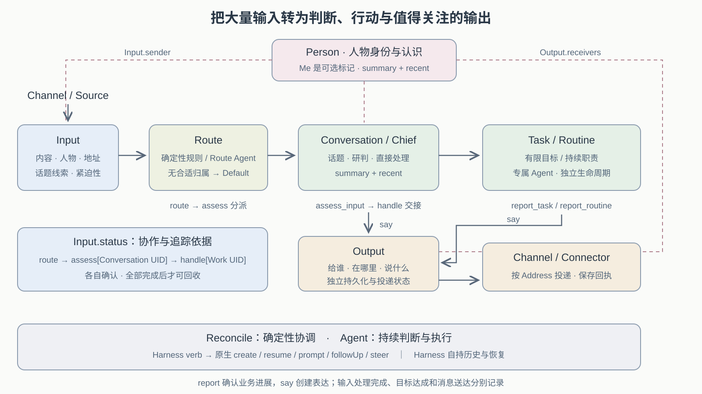

# Personal 业务模型

Personal 是 Aide 的内置个人助手插件：Chief 接收输入并判断是否需要持续跟进，Task 负责有限目标，Routine 负责持续职责。用户可以自然聊天，外部系统也可以带来观察；只有值得承担和推进的工作才进入 Task / Routine。

## 主动性与上下文

Aide 的主动性围绕一个动作展开：把发生的事放入合适的上下文（place it in context），结合那里已有的关注、委托、历史和进展，决定推进、更新、沟通、等待或忽略。归位让一次新变化接上此前的工作。

| 上下文 | 承载什么 | Reconcile 的职责 |
| --- | --- | --- |
| Conversation | 一个话题的交流、近期关注与相关委托 | 理解新输入或定时回顾，直接处理简单事情，将持续工作交给 Work |
| Task | 有限目标、完成条件、相关事实、执行历史与当前阻塞 | 持续推进目标直至完成 |
| Routine | 持续职责、历史基线与当前轮次的目标和进展 | 推进当前轮次直至完成，再等待下一轮触发 |

归位可以涉及零个、一个或多个上下文，也可以止于 Conversation。Input 保留原始事实与来源；关联上下文时，保存引用或将相关事实、用户决定承接到对应资源。需要持续跟进时优先关联已有 Work，再按需要创建 Task / Routine。目标与进展由这些资源持有，Harness 的会话和记忆帮助理解它们。

例如 executor 的 Pod 发生变化，Chief 先找到关注该服务的话题。若话题下已有“跟进 OOM 修复”的 Task，就将变化作为新证据交给它继续核实；若属于稳定性巡检，则进入 Routine 当前轮次的观察；只有近期关注时，Chief 可以核实后直接提醒。没有改变判断的新信息可以静默处理。

## 持续委托

Personal 围绕用户交付的目标持续负责。普通交流可以直接结束；需要保留目标、等待变化并继续推进的事情进入 Work。创建工作前先检查已有委托，将补充信息、用户决定与外部变化关联到同一件事，避免每次触发都重新建任务。

Task 与 Routine 按目标的结束条件区分。Task 达到完成条件后结束，即使它持续一周、经历多次执行或等待，仍然是一个 Task。Routine 承担持续职责，每轮执行结束后继续等待下一次条件满足；频率只是触发方式。例如“跟进这个 PR 直到合入”是 Task，“持续关注我的 PR，有新阻塞就处理或通知”是 Routine。

一项委托的连续性包括目标、进展、已经发生的动作、等待条件和结果依据。执行、等待用户、等待外部变化及恢复都属于同一项工作；每次推进都从最新事实开始。外部动作结果不确定时先核对，避免把已经生效的操作重新执行。停止定时回顾、暂停工作和撤销外部动作分别作用于触发、业务调度和外部系统。

Source 和 trigger 提供重新判断的机会。已有委托决定可以继续承担的工作；相关的新机会可以向用户提出，用户的兴趣与历史偏好用于理解背景。Chief 的主动判断与沟通原则见 [Chief](../harness/chief.md#主动判断与沟通)。

## 主流程

Chief 可以直接处理、回复或保持安静；需要独立跟进的事情，再交给 Task / Routine。

Chief 是业务角色。Chief Controller 消费输入、组织上下文并续接问答；Chief Harness 执行 `agents/chief/` 中的 Agent，使用通用 Pi 能力以及 Personal 工具。Task / Routine 按根级 `defaultHarness` 选择执行实现，缺省为通用 Pi。Chief 的提示词、上下文和记忆优化方向见 [Chief Harness](../harness/chief.md)，插件机制见 [Plugin](README.md)。

## 输入与上下文

Input 由 Core 独立持久化，Conversation 是 Personal 的普通资源。Channel / Source 可提供 sessionId 等已知归属线索，Chief 据此确定话题；没有明确目标时，结合候选上下文判断。Session 承载持久执行与恢复，Conversation 承载话题；一个 Session 默认建立一个 Conversation，也可以组织多个话题。

Chief 有两个 Reconcile。ReconcileInput 负责路由：有明确线索时按规则直接关联，例如目标 Session 唯一的会话；无法确定归属时，由 Chief 的路由调用读取会话摘要和关联 Work，选择零个、一个或多个已知会话。路由调用使用独立上下文和无执行工具的能力范围，不代替目标会话干活。没有相关会话时记录忽略原因。

路由计划保存目标 Session 与资源 uid，再逐个 Update Conversation 的 inputIds。追加按 inputId 去重；中断后继续同一计划，不再次调用模型选择目标。ReconcileConversation 在收到新 Input 或自身 trigger 到期时，加载话题历史、相关 Work 和最新事实，调用 Chief Harness 判断。Chief 承担 System 1 的接话与分流职责：当轮能办完的事情直接处理；需要独立推进、等待和跟踪时，将相关事实与决定承接到已有或新建 Work，由对应 Reconcile 继续。同一 Input 在不同会话的处理状态相互独立。

普通提问不必成为 Work。Input 路由完成、会话处理完成、工作目标完成和消息送达各有自己的状态；等待某个会话的用户或 Harness 时，其它 Session 可以继续。

每个会话绑定一个 Chief Target 和固定 Lane，普通消息、定时回顾及询问后的续答沿用原生 Harness 会话。Chief 获取近期消息，并通过工具查询已有工作和外部详情；记忆由 Chief Harness 组合上游能力，Personal 不感知其实现。

编程领域使用 Repository = forge + path、Requirement = source + category + id、PR/MR = forge + path + number。Chief 在工作指令中保留实体身份与工作目录，不根据仓库名字猜测本地 checkout。

## Conversation 定时回顾

Conversation 与 Routine 的 `trigger` 都是调度机制，只决定何时唤醒 Reconcile；业务判断由各自 Reconcile 负责。Conversation 的定时触发用于持续照看话题。每个 Conversation 独立控制开关与间隔，默认关闭、间隔一小时；Web 提供开关。收到新 Input 和 trigger 到期都会唤醒同一个 Conversation Reconcile，定时唤醒已有明确上下文，不生成外部 Input。

Personal 决定回顾策略，Core 提供通用定时唤醒与恢复能力。Runner 根据 Reconcile 返回的重新入队时间调度，下一次回顾时间与每次处理记录保存在 Conversation 中，重启后恢复，停机错过的周期合并处理；普通消息不会不断推迟到期回顾。回顾与输入处理按会话协调，避免堆积重复工作。关闭 trigger 停止后续定时回顾，已有 Input、Work 与 Source 继续遵循各自生命周期。

Conv 的回顾关注话题中的遗漏、进展、阻塞和可采取的下一步，Routine 的定时触发则承担明确的本轮职责。回顾可以静默结束；需要执行时依据已有委托，需要补充信息或用户决定时再询问。记忆中的意向不自动成为执行委托，也不重复提出没有新依据或用户回应的建议。

Chief 可以推进已有委托、用普通消息提出建议、请求 ask/confirm，或静默结束。`say` 保存普通 Message，由 Channel 独立投递；用户回复 say 是新的 Channel Input。定时回顾仅在有实际消息或问题时通知用户，静默回顾的内部总结不渲染为回复。

## 环境观察

Personal 的 EnvironmentSource 经 Connector Verb 周期采样 Workload；首次静默建立基线，后续将变化合并为 `workload.changed` Input，由 Chief 分配到相关 Conversation，再结合话题与 Work 判断。它与需求 Source 共用输入归位流程。范围、配置、比较与恢复规则见 [Environment 变化](../connector/README.md#environment-变化)。

## 决策与问答

Chief 拥有原生文件/CLI 工具、五个 Work 工具，以及 `read_requirement`、`list_pull_requests`、`read_pull_request`、`read_pull_request_comments`、`list_connectors`。

`ask` 和 `confirm` 工具提出问题意图，Pi 结束当前 Turn 后，Chief Controller 调用已有 Core verb。等待用户不占模型执行位。Core Interaction 持有问题、答复、取消和超时；没有增加第二套审批状态。提出问题之后，当前轮的 Work 写工具拒绝继续修改，收到答复后才重新开放。拒绝是正常业务答案，Chief 收到 `declined`，不能当作执行授权。

网页可直接回答 Interaction；飞书同一会话下一条文字回答当前问题。确认问题接受选项值、标签和明确的“确认／拒绝”等表达；不明确的确认回答会提示选择，不继续执行。自由问答允许文字答案。其它会话的消息不能回答这个问题。当前一次只处理一个问题，不支持飞书引用特定历史问题作答；Hooks 信任和 Harness 权限请求仍在网页处理。

Source 观察没有用户指令的地位。Chief 应读取详情、查询已有 Work；在已有委托内可以推进工作，缺少目标或授权时询问。不值得打扰的观察可调用 `dismiss_observation`，保存原因但不向 Channel 发消息。

普通回复由 Chief Controller 调用 `say` 保存到 Conversation 的 Message 流，Conversation 的处理记录保留消息引用，Core 问题按原 messageId 投影到同一 Channel 消息流。POST `/messages` 返回入站持久回执，业务结果异步出现；没有每次固定发出的“已创建事项”回复。模型进度不会重复投递为最终回复。

Chief 可能调用有副作用的工具，因此运行中断、失败或重启均不自动重放。状态和失败提示保留，用户核对后用新消息重新交办。同一输入 id 的传输重投永远不作为业务重试。等待中的调用栈不跨重启恢复，Core 问题会收口，Conversation 中的处理记录标记 failed；Work 的结果处理见下文。

## 分配与追加输入

ReconcileConversation 可以直接处理、创建或删除工作，也可以用 `append_input` 把原始 Input 交给已有 Task / Routine。创建确立新的目标，删除结束资源生命周期；对已有工作的补充通过输入承接。Chief 不直接修改已有 Work 的执行状态、下次调度时间和执行历史。

共享事实与拆分工作有不同语义：多个 Work 可以引用同一原始 Input，独立消费；当一件大事需要拆分时，派生输入各自说明交付范围，并关联原始 Input。Chief 的交接说明与原始事实分别保留。直接处理、追加和创建可以组合使用，一份 Input 不要求只对应一份 Work。

`append_input` 成功表示投递已持久保存。原始输入通过 `inputId` 关联并保留来源；新请求或交接说明使用 `text`。默认追加上下文；修改定义、暂停、恢复与回答问题使用明确请求，由目标 Work Reconcile 应用。外部观察只作为事实，不能冒充用户控制请求。原始输入按目标与请求去重，Chief 新请求按工具调用身份去重。

Work 的输入队列属于 spec，消费进度与执行状态属于 status。Reconcile 将输入承接到历史并原子提交消费进度与处理结果；运行中新到的输入留待后续处理。暂停、已完成或结果待核对的工作仍可记录新事实，执行恢复需要明确请求。非法请求保留原因与消费记录，不阻塞后续输入。

## Task / Routine 与 Work

Work 接住与自身目标相关的新事实、用户补充和决定，保留来源及有助于下一步判断的历史。每次 Reconcile 结合目标、已有进展和新事实，决定哪些动作现在可以执行、哪些需要等待、提醒或询问用户。Task 的收敛目标是整个有限目标完成；Routine 的收敛目标是当前轮次完成，一轮可以跨越多次执行和等待。Harness 返回或一次 Reconcile 结束，只表示本次处理结束，完成状态还需满足对应的业务条件。

Task 与 Routine 各自的 Controller 观察 ready 或已到期的 scheduled，先保存 running，再请求 Harness 执行。正常结果、问题和状态一起提交；跨越执行等待后按 uid 重读资源，保留用户最新指令与暂停状态。版本冲突只重试提交，不重复执行外部工作。

执行返回 ask 时，工作保存为 waiting 并结束本次调用，用户回答后再唤醒；返回 wait 时保存动态唤醒时间。Routine 完成本轮后继续等待下一次触发，Task 完成后结束。事件触发更新匹配的 Routine，由其 Controller 推进。

`task.ts` 与 `routine.ts` 分别拥有 Reconcile：Task 完成后进入 done，Routine 完成本轮后回到 scheduled，并按自己的触发规则计算下次时间。两者共享 personal 内部的 Harness 调用、结果校验、并发更新处理和 outbox 记录；这些辅助操作位于 `execution.ts`，不进入通用 Host / Runner。

资源类型决定身份；Task 没有周期触发配置，Routine 必须有 cron 或事件触发。Work 工具与网页聚合这两类资源，对外仍返回 task / routine 分类。Chief 的会话处理观察 Personal 定义的 Conversation 资源。

改变工作类型由 Chief 组合现有工具：读取原工作的目标与结果，创建目标类型的新工作，再按用户意图暂停或删除原工作。新工作使用独立 id 和执行 Lane，相关上下文写入指令；保留原工作可查看完整历史，删除则将已交付消息与输入回执归档到 Conversation。各步分别持久化，不承诺跨资源的原子转换；中断后应查询现状再继续。暂停和删除都不取消已经运行的外部动作。

## 完成依据与交付

Task 的目标应包含可判断的完成条件；Routine 应说明每轮检查什么、哪些变化需要处理或通知。执行者返回的结论需要结合工具结果、产物和外部状态解释，例如 PR 是否已合入、测试是否通过、文件是否包含预期内容。结果格式校验保证返回值可处理，业务完成条件决定目标是否达成。

Personal 的 Controller 负责解释执行结果并推进工作状态，Core 保存执行事实。领域专用验收由对应 Controller 通过 Core Verb 查询外部系统或请求验证，开放问题则由 Harness 调查并提供依据。无法确认的部分保留为待核对或等待，向用户说明缺口。

工作完成和消息送达分别记录。通知失败只影响交付，不能让已完成的业务动作重新执行；交付应说明结果、依据以及仍需用户决定的事项。

## Work 工具与执行结果

| 工具 | 行为 |
| --- | --- |
| `list_work` | 列出绑定会话的 Task / Routine |
| `read_work` | 读取目标、状态、历史、revision 和待回答问题 |
| `create_work` | 创建工作并唤醒对应 Reconcile |
| `append_input` | 追加原始输入、交接说明或控制请求，由 Work Reconcile 消费 |
| `delete_work` | 请求删除，停止后续调度并保留已交付消息 |

WorkService 绑定宿主确定的 conversationId，模型不能传入其它会话范围。读操作不唤醒执行，输入追加通知对应 Reconcile，删除需要最近读取的 revision。输入追加不直接改变业务状态。删除前归档消息和输入回执，已运行回调不能重建被删资源。

Task / Routine 校验 Harness 的 finalText。执行失败或中断标为 uncertain，执行已结束但结果无法解析或校验则标为 invalid_result；两者均等待用户核对后明确继续，不自动重放。业务等待用户则保存为 waiting，收到回答后由 Reconcile 继续，能够跨服务重启恢复。

Chief 的问答使用 Core Interaction 与当前回调续接，调用栈不跨重启恢复；不能把它与 Task / Routine 的 waiting 状态混同。上下文结合近期消息、工作记录及连接器查询，Chief Harness 按需提供相关记忆；工作状态以 Task / Routine 为准。

## 验证

`tests/chief.test.ts` 验证真实 Runner、Pi SDK、需求观察、确认拒绝、自由回答和创建工作的链路；模型、平台与 Work 执行使用替身。会话、独立 Task / Routine 生命周期和中断处理另有契约测试。真实环境验收见 [E2E](../e2e.md)。
